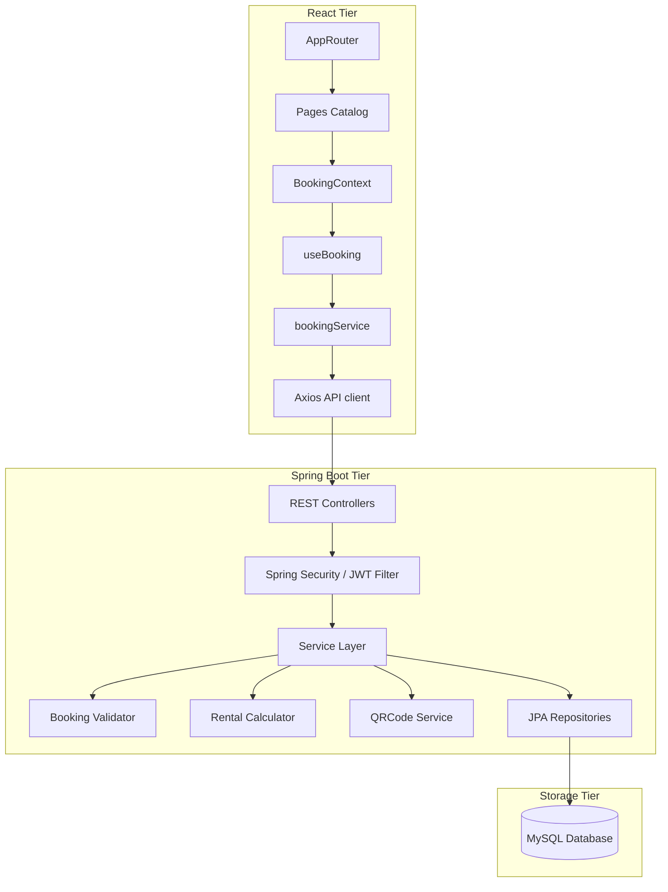
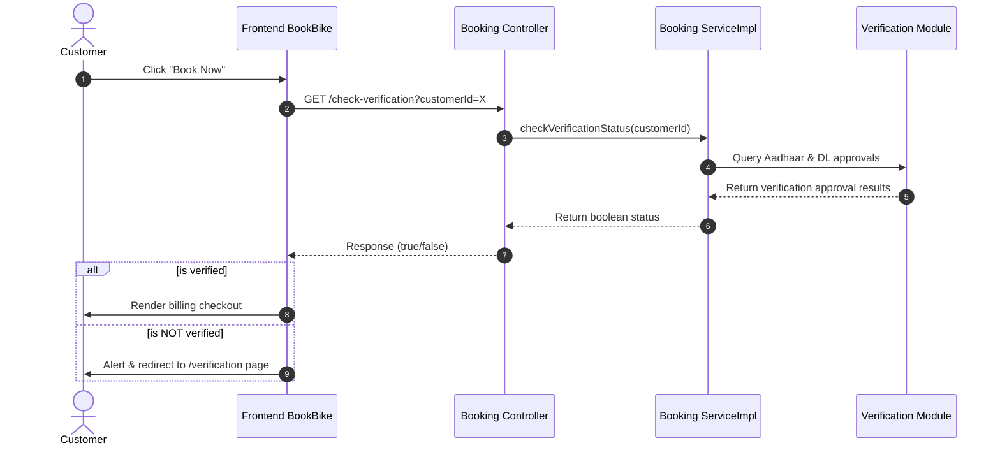
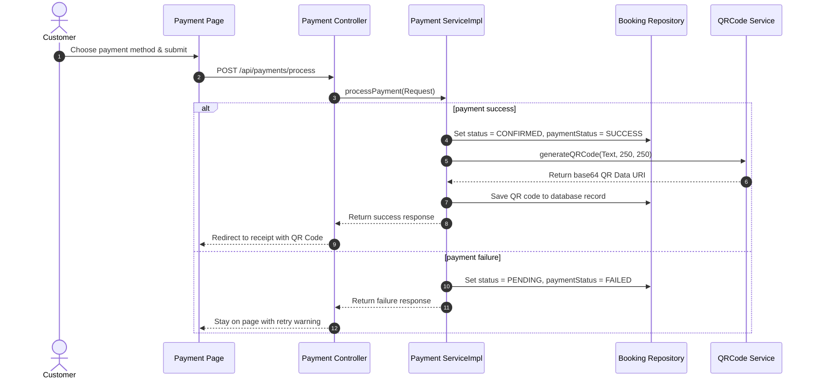

# System Architecture Documentation

The Bike Rental System is built on a clean three-tier architecture connecting the React frontend, Spring Boot API gateway, and the MySQL database engine.

---

## 1. High-Level Architecture Diagram

---

## 2. Integrated Core Flows

### 2.1 Verification Flow Diagram

### 2.2 Payment & QR Code Flow Diagram

