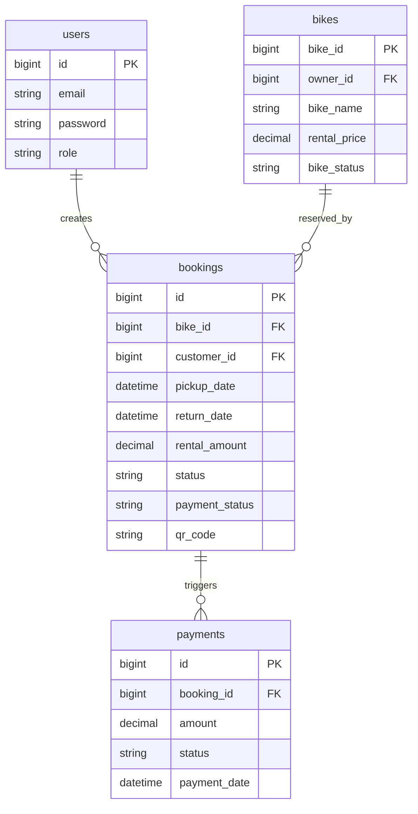

# Booking Database Documentation

This document describes the schema structure, constraints, indexes, and entity relationships for the tables associated with the Booking Module.

## 1. Booking Entity Schema (`bookings`)

| Column Name | Data Type | Nullable | Key / Index | Description |
| :--- | :--- | :--- | :--- | :--- |
| `id` | `BIGINT` | `NO` | Primary Key | Identity primary key |
| `bike_id` | `BIGINT` | `NO` | Index: `idx_bookings_bike_id` | Logical Foreign Key to `bikes.bikeId` |
| `customer_id` | `BIGINT` | `NO` | Index: `idx_bookings_customer_id` | Logical Foreign Key to `users.id` |
| `pickup_date` | `DATETIME` | `NO` | - | Date/time when renter takes the bike |
| `return_date` | `DATETIME` | `NO` | - | Date/time when renter returns the bike |
| `rental_amount`| `DECIMAL(10,2)`| `NO` | - | Calculated subtotal amount |
| `status` | `VARCHAR(32)` | `NO` | Index: `idx_bookings_status` | Booking lifecycle status |
| `payment_status`| `VARCHAR(32)`| `NO` | - | Transaction payment status |
| `qr_code` | `VARCHAR(1000)`| `YES` | - | Encoded Base64 QR code image payload |

## 2. Payment Entity Schema (`payments`)

| Column Name | Data Type | Nullable | Key | Description |
| :--- | :--- | :--- | :--- | :--- |
| `id` | `BIGINT` | `NO` | Primary Key | Identity primary key |
| `booking_id` | `BIGINT` | `NO` | - | Foreign Key to `bookings.id` |
| `amount` | `DECIMAL(10,2)`| `NO` | - | Total amount billed (rental + GST) |
| `status` | `VARCHAR(32)` | `NO` | - | Status (`SUCCESS` / `FAILED` / `PENDING`) |
| `payment_date` | `DATETIME` | `NO` | - | Timestamp of transaction |

---

## 3. Entity Relationship Diagram (ERD)

